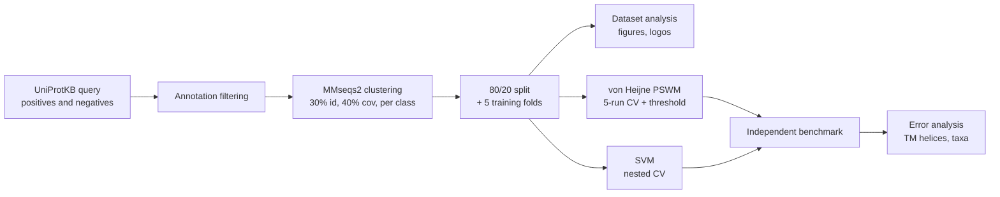

## Methods and results

This section documents everything that was done, from the raw UniProt download to the final comparison of the two
predictors. Lines marked `TODO` must be checked or filled from the files in `results/` before the section is merged.

### 1. Pipeline overview

The task is binary: does a eukaryotic protein carry a secretory signal peptide (SP)? Two methods are compared on the
same data partition: the **von Heijne weight-matrix method** (1986), a motif-based baseline built only from the
cleavage-site context, and an **RBF-kernel support vector machine** that learns from global N-terminal features.

### 2. What was done, step by step

| # | Step | What was done | Code | Output |
|---|---|---|---|---|
| 1 | Data collection | Reviewed, non-fragment eukaryotic UniProtKB entries (release 2026_03), length at least 40. Positives: experimental SP evidence (ECO:0000269), protein-level existence, known cleavage site, SP length at least 14. Negatives: no SP annotation at any evidence level, and experimental localization in cytosol, nucleus, mitochondrion, plastid, peroxisome or cell membrane (membrane proteins are kept on purpose as hard cases). | `collect_negative_candidates.py` | `data/raw/` |
| 2 | Annotation filtering | 16 of 2,972 candidate positives were removed: 6 annotated "Not cleaved" (2 of them with unknown cleavage position), 9 with an SP shorter than 14 residues, 1 with an ER-targeting note instead of a regular cleavable SP. All 20,974 negatives were kept. | `filter_positives.py`, `filter_negatives.py` | `data/processed/` |
| 3 | Redundancy reduction | Positives and negatives clustered separately with MMseqs2 (`--min-seq-id 0.3 -c 0.4 --cov-mode 0 --cluster-mode 1`); one representative per cluster. This prevents similar proteins from appearing on both sides of a split. | `src/preprocessing.py` | `data/processed/` |
| 4 | Train / benchmark split | Representatives split 80/20 at random, stratified by class (seed 42). The training set is divided into five stratified folds (`cv_fold` 0 to 4). | `src/preprocessing.py` | `data/splits/` |
| 5 | Dataset analysis | Length distributions, kingdom and species composition, amino-acid composition of annotated SPs against Swiss-Prot, and sequence logos of the 15-residue cleavage window (13 residues before the cut, 2 after). | `src/visualization.py` | `figures/` |
| 6 | von Heijne method | Weight matrix, threshold selection and cross-validation (section 4). | `src/models.py` | `results/` |
| 7 | SVM | Feature extraction, Random-Forest feature selection, nested cross-validation (section 5). | `src/svm.py` | `results/` |
| 8 | Benchmark comparison | Both final models scored once on the independent benchmark; ROC and precision-recall curves. | `src/benchmark.py` | `results/` |
| 9 | Error analysis | False positives against N-terminal TM helices, errors per kingdom (section 7). | `src/benchmark.py` | `results/` |

### 3. Dataset

| Stage | Positive | Negative | Total |
|---|---|---|---|
| Downloaded candidates | 2,972 | 20,974 | 23,946 |
| After annotation selection and preparation | 2,956 | 20,974 | 23,930 |
| MMseqs2 representatives | 1,104 | 9,082 | 10,186 |
| Training (five stratified folds) | 883 | 7,265 | 8,148 |
| Independent benchmark | 221 | 1,817 | 2,038 |

- About 10.8% of the proteins are positive, in the training set, in the benchmark and in every fold. Accuracy alone is
  therefore misleading (always answering "no SP" would score about 89%), so the **Matthews correlation coefficient
  (MCC)** is the main metric.
- The signal peptide always starts at residue 1. The cleavage site (last SP residue) ranges from 14 to 83 with a median
  of 22.
- The negatives include membrane proteins. The column `tm_helix_first_90` marks the negatives with a transmembrane helix
  starting within the first 90 residues; it is used only for evaluation, never for training.

### 4. von Heijne method

**Idea.** Signal peptides end in a weakly conserved cleavage-site context. A position-specific weight matrix (PSWM)
captures which residues are over- or under-represented at each position around the cleavage site, relative to what is
expected by chance.

**Building the matrix**
1. Extract the 15-residue window `[-13, +2]` around the cleavage site of every training positive.
2. Count the residue at each of the 15 positions, starting every cell at 1 (pseudocount), and normalize to
   probabilities (the position-specific probability matrix).
3. Divide by the background amino-acid frequencies of Swiss-Prot and take the logarithm: `W[k, j] = log(M[k, j] / b[k])`.
   Positive weights mean enrichment at that position, negative weights depletion.

**Scoring a protein.** Slide the 15-residue window over the first 90 residues of the sequence, score each valid window as
the sum of its weights, and keep the highest score as the protein's signal-peptide score. A protein is predicted
positive when this score reaches a threshold.

**Choosing the threshold (never on the test data).** Five runs of cross-validation: in each run three folds fit the
matrix, the next fold selects the MCC-optimal threshold, and a separate fold measures performance. For the final model,
one cutoff is chosen from training-only out-of-fold scores, the matrix is refitted on all training positives, and the
benchmark is scored once.

**Cross-validated performance (mean ± standard error over five runs):** `TODO: insert from results/`

### 5. Support vector machine

**Idea.** Describe each protein by features of its N-terminus, then learn a non-linear decision boundary
(RBF kernel) between proteins with and without a signal peptide.

**Features**
- **N-terminal composition:** fraction of each of the 20 amino acids in the first *n* residues, with *n* the median SP
  length of the current training set (22 on the whole training set).
- **Hydropathy:** Kyte-Doolittle profile (window 5) over the first 40 residues: maximum, mean and position of the peak.
- **Charge:** net charge of residues 1 to 10 (K, R positive; D, E negative).

`TODO: confirm the feature list and window sizes against src/svm.py`

**Model.** Features, then Random-Forest importance ranking (500 trees, fixed seed), then the top-*k* features,
then `StandardScaler`, then `SVC(kernel="rbf", class_weight="balanced")`.

**Protocol: nested cross-validation on the predefined folds**
- *Outer loop (performance):* each of the five folds is the test set once.
- *Inner loop (model selection):* 4-fold cross-validation on the remaining folds chooses *k*, *C* and gamma by mean MCC.
- *n*, the feature ranking, the scaler and the SVM are all fitted on training data only, separately in every fold, so the
  test fold never influences a choice.
- *Final model:* 5-fold cross-validation over the grid on the whole training set, refit on the whole training set, then
  one evaluation on the benchmark.

**Nested cross-validation (mean ± standard error over five outer folds):**

| MCC | Precision | Recall | F1 | Accuracy |
|---|---|---|---|---|
| 0.806 ± 0.003 | 0.771 ± 0.005 | 0.890 ± 0.006 | 0.826 ± 0.003 | 0.959 ± 0.001 |

`TODO: verify these figures against the per-fold table in results/`

### 6. Independent benchmark results

| Method | MCC | Precision | Recall | F1 | Accuracy | ROC AUC |
|---|---|---|---|---|---|---|
| von Heijne | 0.657 | 0.708 | 0.679 | 0.693 | 0.935 | 0.952 |
| SVM | 0.853 | 0.840 | 0.900 | 0.869 | 0.971 | 0.981 |

Confusion counts on the 2,038 benchmark proteins (consistent with the rates above; `TODO: check against results/`):

| Method | TP | FN | FP | TN |
|---|---|---|---|---|
| von Heijne | 150 | 71 | 62 | 1,755 |
| SVM | 199 | 22 | 38 | 1,779 |

The two cross-validation protocols differ in training size and tuning scheme, so the shared independent benchmark is the
direct comparison. The SVM scores clearly higher on every metric. A gap of this size (MCC 0.66 against 0.85) is large
compared with the sampling noise of 221 positives, but no paired significance test has been run yet.

### 7. Error analysis

**False positives and N-terminal transmembrane helices.** The hydrophobic stretch of an N-terminal TM helix resembles
the h-region of a signal peptide, so both methods are expected to confuse them.

| Negatives | von Heijne false positives | SVM false positives |
|---|---|---|
| With a TM helix starting within the first 90 residues (185) | 28 (15.1%) | 19 (10.3%) |
| Without one (1,632) | 34 (2.1%) | 19 (1.2%) |

Both methods are about seven to ten times less specific on the TM subset, and the SVM makes fewer false positives in
both groups.

**False negatives.** For the SVM, the missed signal peptides tend to have less alanine and leucine in the N-terminus than
the correctly detected ones. With only a few dozen cases this is a tendency, not a result.
`TODO: add the von Heijne false-negative cleavage-site logo (expected vs missed) from figures/`

**Taxonomy.** The benchmark contains few positives outside Metazoa (roughly 16 plant, 17 fungal and 5 other), so
per-kingdom error rates are very uncertain. See the subgroup tables in `results/`.

### 8. Limitations

- With 221 benchmark positives, any metric carries an uncertainty of a few hundredths; small differences should not be
  over-interpreted.
- After clustering, fungi are about 28% of the negatives but only about 9% of the positives (Metazoa: 53% against 79%).
  A composition-based model may partly learn taxonomic signal; the per-kingdom analysis is there to check this.
- Some negatives are multi-localized proteins that also carry a secretory annotation but no signal peptide.
- A few sequences contain non-standard residues (U, B, X); they are ignored when computing composition.
- The Random-Forest selection kept all features in every fold in our runs, so it did not reduce the feature set.
- Only the Sec/SPI-like, cleaved signal peptides with experimental evidence are modeled; leaderless secretion and
  uncleaved signal anchors are outside the task.

### 9. Next steps
- Paired significance test (McNemar) and bootstrap confidence intervals for the MCC difference.
- Extended SVM feature set separating signal peptides from TM helices (longer hydropathy window, hydrophobic run length,
  n-region charges, c-region polarity); on the training set it raised the cross-validated MCC from 0.817 to 0.861,
  to be confirmed with the repository's own pipeline before reporting.
- Ablations: linear against RBF kernel, with and without class weighting.

## Authors and contributions

| Member | GitHub | Main contributions |
|---|---|---|
| [name] | [@handle] | Data collection and annotation filtering |
| [name] | [@handle] | Redundancy reduction, splits and cross-validation folds |
| [name] | [@handle] | Dataset analysis and figures |
| [name] | [@handle] | von Heijne method and its cross-validation |
| [name] | [@handle] | SVM: features, nested cross-validation, final model |
| [name] | [@handle] | Benchmark comparison, error analysis and report |

Every member should be able to explain every step of the pipeline in the oral exam.
